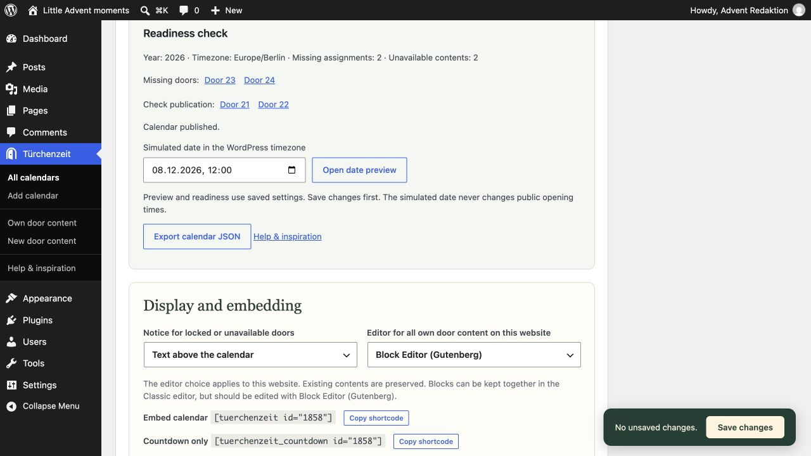
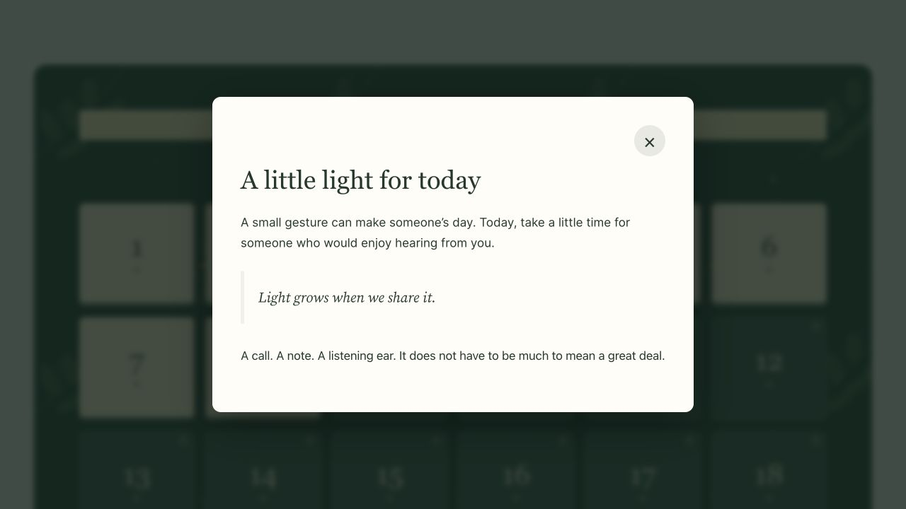
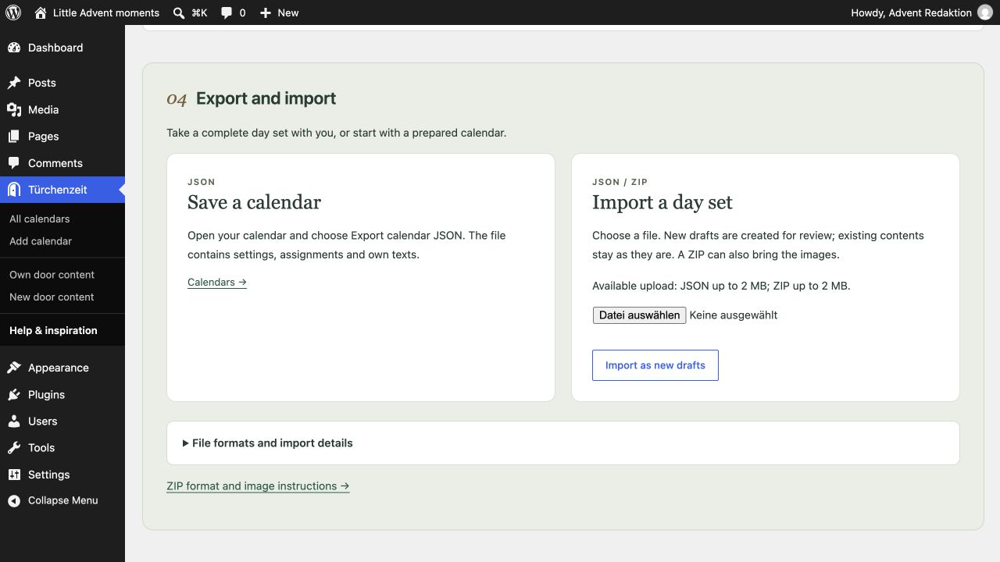
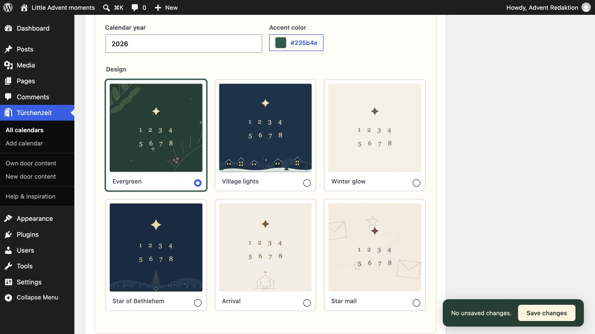
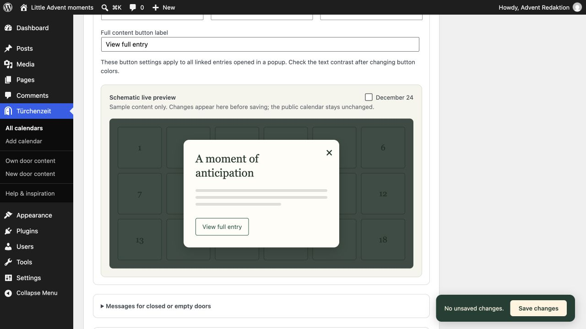

# FAQ by topic

[Deutsch](FAQ-de)

## Getting started

### How do I embed a calendar?

Use [tuerchenzeit id="123"], replacing 123 with the calendar ID shown in the editor. [adventskalender id="123"] is an alias. JavaScript is required for opening doors and showing the countdown.

### Can I place the countdown separately?

Use [tuerchenzeit_countdown id="123"]. Add countdown="0" to the calendar shortcode to hide its own countdown. The countdown ends on December 1 at 00:00 in the calendar year and WordPress timezone.

### How do I preview future doors?

Readiness lists missing assignments, unavailable contents, year and timezone. A saved calendar offers a private date simulation in the WordPress timezone, restricted to authorized administrators. Public opening times never change. Alternatively, [tuerchenzeit id="123" preview="1"] opens all assigned contents including own drafts.

*Readiness distinguishes missing assignments from unpublished content and provides the private date preview.*

## Opening times and privacy

### Are future contents private?

Own door content is excluded from the standard WordPress search and has no public single-entry page. Visitors see it through an opened calendar door; REST access is restricted to administrators. Linked posts and pages normally remain publicly accessible and searchable. The opt-in setting protects originals assigned to published calendars until opening, including direct URLs, the standard WordPress search and other standard access paths. The earliest opening across all protecting calendars wins; drafts lock nothing. Removing the last protecting assignment removes the lock. Purge caches and exclude original URLs from page caching when enabling protection. Protection requires the plugin to stay active and does not cover public media files or external copies.

### What happens after Christmas or if content disappears?

Opened doors stay accessible. An optional editable greeting appears from December 25 onward. The today button appears only December 1–24 in the calendar year. Deleted, private, password-protected and unpublished linked originals are unavailable. Visited markers are optional and saved locally only after enabling them on that browser.

## Content and design

### What content and data are supported?

Choose Classic or Block Editor (Gutenberg) for your own contents. Standard text, image, gallery, column and video blocks are rendered in the dialog. YouTube URLs on their own paragraph and YouTube Embed blocks become click-to-load players. Arbitrary third-party iframes are not permitted. Linked previews show an excerpt and link. Deactivation and uninstallation preserve calendars, contents, pages, editor preference and assignments. *Daily Scripture* supports fixed local passages via its Bible Passage block and [`daily_scripture_passage` ...], when the plugin and desired Bible edition are set up. Other shortcodes are not executed.

*Own door content in the private December 8 date preview; public opening times stay unchanged.*

## Reuse and transfer

### How do I prepare the next year without changing the live website?

Use Prepare next year in the saved calendar. It creates a new calendar draft with the next year and independent drafts of its own contents; linked entries are reused. Publish the new contents and calendar when ready. In the original calendar, set the switch time in the WordPress timezone (default: November 1 of the next year). The original shortcode and landing-page URL then display the new published edition. Drafts never replace the live calendar; an empty switch date disables switching. Under Popup and button appearance, change colors, overlay opacity, button label, outline/fill and corners. Empty color fields inherit the design. Messages for closed or empty doors provides separate texts with {tuerchen}, {tag}, {datum} and {uhrzeit}; paragraphs, bold and italic are supported. In the page editor, find optional sections under Patterns → Türchenzeit and replace the existing header or footer. Set the outer group to Full width; the original landing layout stays the default.

### How do I transfer a calendar?

Export JSON from the calendar editor (2 MB maximum). Under Help & inspiration, import JSON or a ZIP (20 MB maximum) containing calendar.json and raster images in media/. ZIP images enter the media library; matching content URLs, featured images and door images are remapped. New calendar and content drafts are created. Local original URLs are remapped; unresolved references stay empty. Other embedded URLs remain unchanged. Original protection starts off; annual-edition links are not imported. ZIP needs the PHP ZIP extension. SVG is not supported.

*Export saves JSON. Import creates new drafts; this example shows the actual upload limit of the test environment.*

### How do I style my doors?

Patterns → Türchenzeit includes daily reflection, verse and reflection, video and picture stories plus optional headers and footers. The extra palette preserves theme colors and adds design/accent colors. Door pictures appear only after opening. Mixed number positions remain stable; animations are optional and respect reduced motion.

*Design choices with year and accent color; Evergreen is selected.*

### What should I check with caches?

Do not cache calendar requests to admin-ajax.php. When enabling original protection, purge page/CDN/REST caches and exclude original URLs from full-page caching. Responses served before WordPress runs, third-party indexes and public media need separate protection. This is not a compatibility claim for any specific cache/CDN vendor.

## Shortcodes: popup or full page?

**In a calendar popup**

Own door contents and calendar popups do not execute general shortcodes. *Daily Scripture* is a supported exception: its fixed Bible passage shortcode can show one verse or a longer passage when the plugin and Bible edition are available.

**On the full entry page**

For other shortcodes, assign a post, page or suitable public content type and select Go to entry. The full page uses the normal WordPress output, provided the relevant plugin and template support those shortcodes. Choosing another content type alone does not change the popup rules.

The popup is intended for manageable daily contents. Other shortcodes may require complete layouts, forms, scripts or styles that cannot generally be guaranteed in a popup loaded after the page. *Daily Scripture* is a deliberately integrated exception.

## The name and its inspiration

### What does “Türchenzeit” mean?

It is a German name combining Türchen, a little door, with Zeit, meaning time or season. It evokes the familiar ritual of opening a little Advent calendar door each day. We keep the German name in English, too. The calendar runs from December 1 to 24, with room for whatever you would like to share behind each door.

### What are the Ore Mountains?

The Erzgebirge, known in English as the Ore Mountains, is a mountain region along the German–Czech border. David comes from the German side, where Christmas woodcraft and illuminated window decorations are deeply rooted traditions. You do not need to know the region to enjoy the plugin; it is the source of its warm, unhurried Advent atmosphere.

### Can I create a Christian Advent calendar?

Yes. Advent means arrival. For Christians, it is a season of expectation and preparation for Christmas, the celebration of the birth of Jesus Christ, the Savior. The Star of Bethlehem and Arrival designs reflect that meaning. Share Bible passages, reflections, or daily devotions, or choose another design for a calendar with a theme of your own.

### Does my calendar have to look like a German Christmas scene?

No. The regional inspiration shapes the warmth of the included designs. Your content, colors, and page patterns are yours to change. Add the calendar to your current website or give it an Advent landing page of its own.

The Daily Scripture button opens the deckerweb Library catalog when the plugin is not installed. If it is installed but inactive, the button offers WordPress activation. Once active, it opens the Daily Scripture admin area. Available actions depend on your permissions; nothing is installed automatically.

### Can I activate Türchenzeit across a multisite network?

Yes. Network activation makes Türchenzeit available on every website in the network, including websites added later. Each website keeps its own calendars, daily contents, landing pages, editor preference, and WordPress timezone. Authorized administrators configure them in that website’s dashboard. Network activation does not create any calendars or pages automatically. This makes it possible to run separate Advent websites for different topics.

### Can I preview popup colors before saving?

Yes. Popup and button appearance includes a schematic live preview with sample content. It shows styling changes before saving and offers a December 24 view. Public calendar settings change only when saved.

*The schematic preview shows sample content and the button; saving applies settings to the calendar.*
