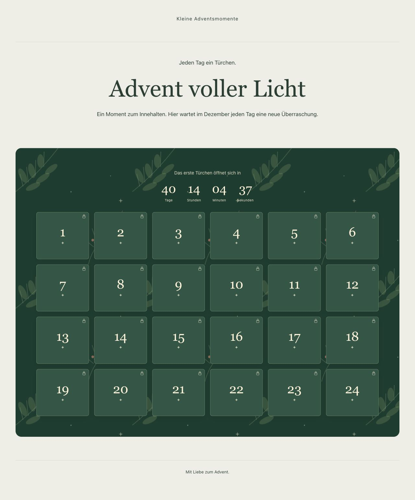
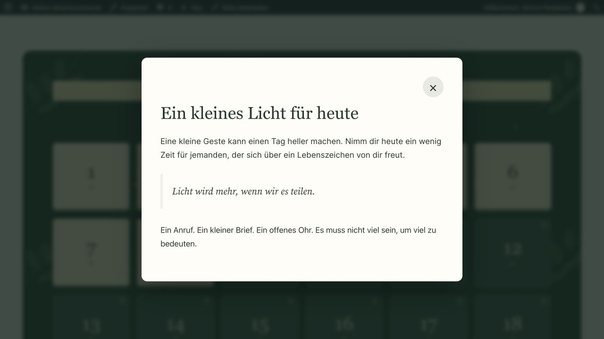
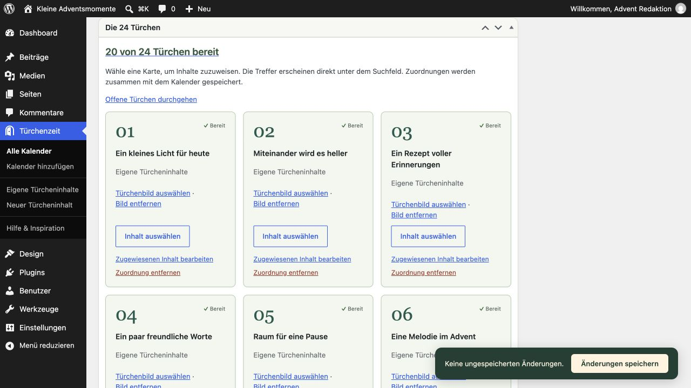
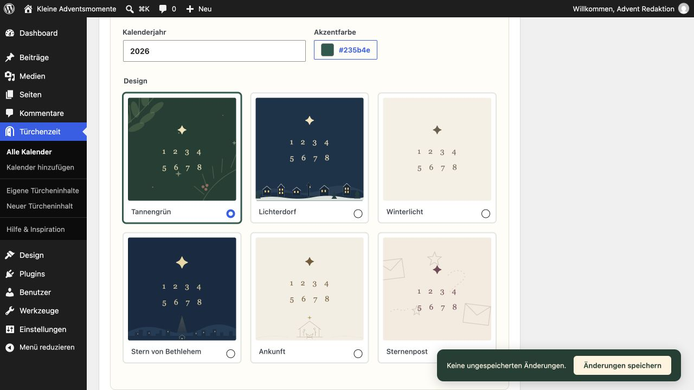
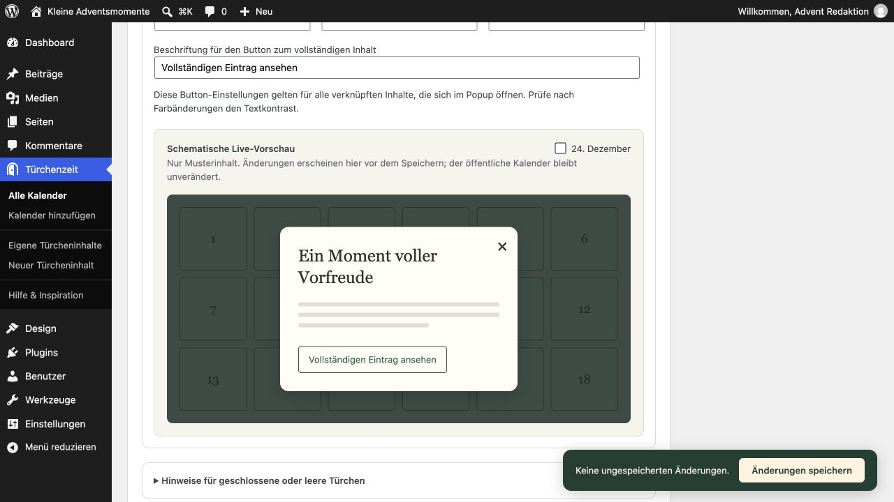
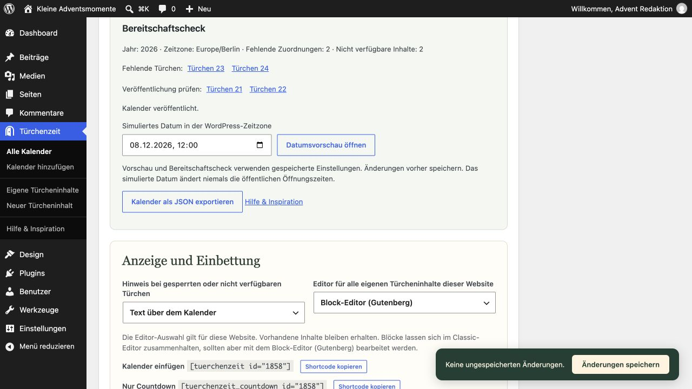
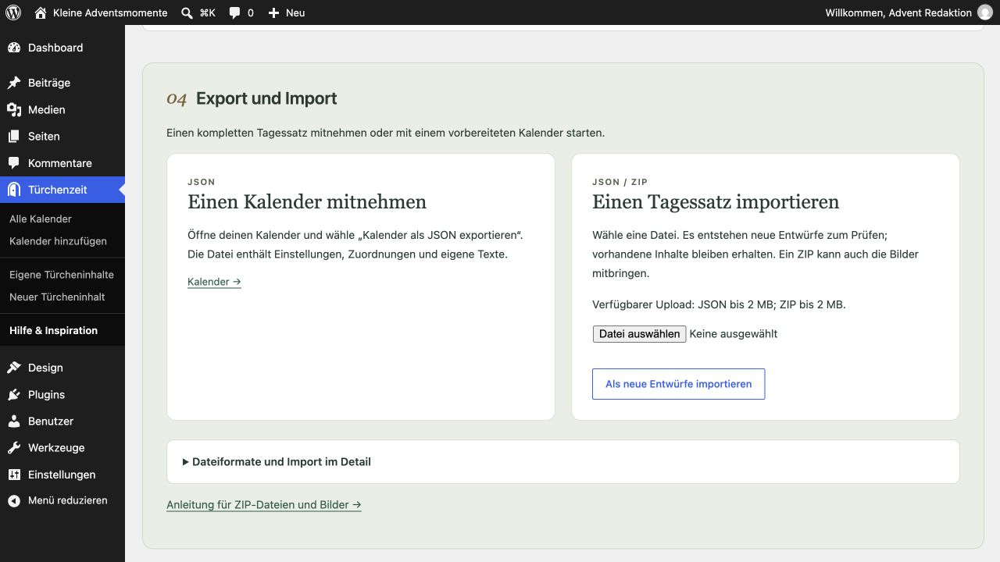

# Türchenzeit: bebilderte Anleitung

[English](Guide-en.md) · [FAQ](FAQ-de.md)

## Die eigene Adventswebsite

Normale Besucherseite vor dem 1. Dezember: Countdown und 24 geschlossene Türchen.

*Normale Besucherseite vor dem 1. Dezember: Countdown und 24 geschlossene Türchen.*

## Ein geöffnetes Türchen

Eigener Türcheninhalt in der privaten Datumsvorschau für den 8. Dezember; die öffentlichen Öffnungszeiten bleiben unverändert.

*Eigener Türcheninhalt in der privaten Datumsvorschau für den 8. Dezember; die öffentlichen Öffnungszeiten bleiben unverändert.*

## Die 24 Türchen verwalten

Das Raster zeigt 20 fertige Tage, zwei unveröffentlichte Inhalte und zwei noch fehlende Zuordnungen.

*Das Raster zeigt 20 fertige Tage, zwei unveröffentlichte Inhalte und zwei noch fehlende Zuordnungen.*

## Sechs Designs zur Wahl

Die Designauswahl mit Jahr und Akzentfarbe; Tannengrün ist ausgewählt.

*Die Designauswahl mit Jahr und Akzentfarbe; Tannengrün ist ausgewählt.*

## Popup-Gestaltung vor dem Speichern prüfen

Die schematische Live-Vorschau zeigt Beispielinhalt und den Button; erst Speichern übernimmt Einstellungen in den Kalender.

*Die schematische Live-Vorschau zeigt Beispielinhalt und den Button; erst Speichern übernimmt Einstellungen in den Kalender.*

## Fehlende Inhalte vor dem Start erkennen

Der Bereitschaftscheck unterscheidet fehlende Zuordnungen und unveröffentlichte Inhalte; darunter öffnet sich die private Datumsvorschau.

*Der Bereitschaftscheck unterscheidet fehlende Zuordnungen und unveröffentlichte Inhalte; darunter öffnet sich die private Datumsvorschau.*

## Tagessätze übertragen

Export sichert JSON. Import erzeugt neue Entwürfe; das Beispiel zeigt die tatsächlich verfügbare Uploadgrenze dieser Testumgebung.

*Export sichert JSON. Import erzeugt neue Entwürfe; das Beispiel zeigt die tatsächlich verfügbare Uploadgrenze dieser Testumgebung.*

## Optionale lokale Schriften

Wähle in eigenen Türcheninhalten oder auf einer eigenständigen Advents-Landingseite einen Textblock aus und öffne Typografie → Schrift (Schriftfamilie). Dort stehen Türchenzeit · Source Serif 4 und Türchenzeit · Inter zur Wahl. Falls das Feld fehlt, blende Schrift über das Optionsmenü der Typografie ein. Mit Standard kehrst du zur geerbten Theme-Schrift zurück.

Die beiden Schriften sind optional und werden lokal unter der SIL Open Font License mitgeliefert. Eine Installation in der Schriftbibliothek oder ein externer Schriftdienst ist nicht erforderlich. Die Theme-Typografie bleibt erhalten, bis du eine Schrift auswählst. Der Browser lädt Schriftdateien erst für Text, der sie verwendet. Die Plugin-Schriften stehen zur Verfügung, solange Türchenzeit aktiv ist.

Zehn Inhaltsvorlagen bieten bearbeitbare Ausgangspunkte: Impuls, Bibelvers, Video, Bildergeschichte, Omas Rezeptbuch, eine kleine gute Tat, Adventsbrief, Lied, Kreativzeit und Abendgebet oder Segen. Alle verwenden WordPress-Standardblöcke. Ersetze Beispieltexte und leere Medienblöcke vor dem Veröffentlichen.

## Ein Netzwerk, viele Adventswebsites

Mit einer netzwerkweiten Aktivierung kannst du eigenständige Adventswebsites zu verschiedenen Themen betreiben: etwa Rezepte, Musik, Andachten oder ein Projekt vor Ort. Jede Website behält ihre eigenen Kalender, Inhalte, Landingseiten, Einstellungen und ihre WordPress-Zeitzone. Türchenzeit steht auch später hinzugefügten Websites zur Verfügung. Berechtigte Administratoren richten jede Website separat ein; die Netzwerkaktivierung legt keine Seiten oder Kalender automatisch an.
