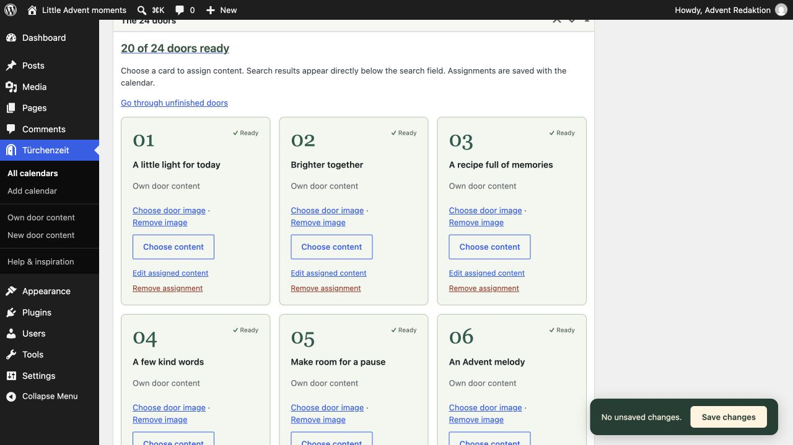

# Türchenzeit: illustrated guide

[Deutsch](Guide-de.md) · [FAQ](../FAQ.md)

## Your own Advent website

Public page before December 1: a countdown and 24 closed doors.

*Public page before December 1: a countdown and 24 closed doors.*

## An opened door

Own door content in the private December 8 date preview; public opening times stay unchanged.

*Own door content in the private December 8 date preview; public opening times stay unchanged.*

## Manage the 24 doors

The grid shows 20 ready days, two unpublished contents, and two missing assignments.

*The grid shows 20 ready days, two unpublished contents, and two missing assignments.*

## Choose from six designs

Design choices with year and accent color; Evergreen is selected.

*Design choices with year and accent color; Evergreen is selected.*

## Preview popup styling before saving

The schematic preview shows sample content and the button; saving applies settings to the calendar.

*The schematic preview shows sample content and the button; saving applies settings to the calendar.*

## Find missing content before launch

Readiness distinguishes missing assignments from unpublished content and provides the private date preview.

*Readiness distinguishes missing assignments from unpublished content and provides the private date preview.*

## Transfer day sets

Export saves JSON. Import creates new drafts; this example shows the actual upload limit of the test environment.

*Export saves JSON. Import creates new drafts; this example shows the actual upload limit of the test environment.*

## Optional local fonts

In your own door contents and standalone Advent landing pages, select a text block and open Typography → Font (font family). Choose Türchenzeit · Source Serif 4 or Türchenzeit · Inter. If the control is hidden, enable Font from the Typography options menu. Choose Default to return to the inherited theme font.

The two fonts are optional and supplied locally under the SIL Open Font License. No Font Library installation or external font service is needed. Theme typography stays unchanged until you choose a font. Browsers download font files only for text that uses them. Plugin font choices require Türchenzeit to remain active.

Ten content patterns offer editable starting points: reflection, verse, video, picture story, Grandma’s recipe book, a small act of kindness, an Advent letter, a song, creative December hours, and evening prayer or blessing. All use standard WordPress blocks. Replace sample text and empty media blocks before publishing.

## One network, many Advent websites

Network activation lets you run independent Advent websites for different topics: recipes, music, reflections, or a local community project. Each website keeps its own calendars, contents, landing pages, settings, and WordPress timezone. Türchenzeit is also available on websites added later. Authorized administrators configure each website separately; network activation creates no pages or calendars automatically.
