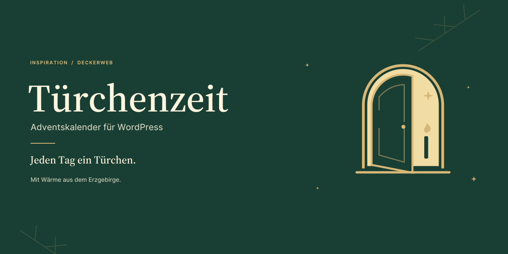

# Türchenzeit

[English](../) · [GitHub](https://github.com/deckerweb/tuerchenzeit)

Türchenzeit bringt 24 kleine Adventsmomente auf deine WordPress-Website. Kombiniere eigene Türcheninhalte mit vorhandenen Beiträgen oder Seiten, wähle ein passendes Design und lass jeden Tag ein neues Türchen öffnen. Auf Wunsch entsteht daraus eine vollständig bearbeitbare Adventswebsite – einmal eingerichtet, jedes Jahr mit neuen Inhalten. Ein Projekt aus der Serie Inspiration, mit Wärme aus dem Erzgebirge.

**1.0.1 · WordPress ab 6.9 · PHP ab 8.3**

## Auf einen Blick

- **Deine eigene Adventswebsite** – bearbeitbare Landingpage mit optionalen Header- und Footer-Vorlagen.
- **24 Türchen, deine Inhalte** – eigene Tagesinhalte und bestehende Beiträge oder Seiten kombinieren.
- **Sechs Designs mit Charakter** – individuelle Akzentfarben und anpassbare Popups.
- **Jeden Tag ein neuer Moment** – zeitgesteuerte Freigabe und optionaler Dezember-Countdown.
- **Einmal gestalten, jedes Jahr nutzen** – neue Jahresausgaben über die bestehende Adresse bereitstellen.
- **Mit Überblick vorbereiten** – Türchenraster, Bereitschaftscheck und private Datumsvorschau.
- **Komplette Tagessätze übernehmen** – JSON-/ZIP-Import samt Bildern.

- [Bebilderte Anleitung](../Guide-de)
- [Vollständige Dokumentation](../manual-de.html)
- [Fragen nach Themen](../FAQ-de)

[Security](https://github.com/deckerweb/tuerchenzeit/security/policy) · [Support](https://github.com/deckerweb/tuerchenzeit/discussions)
