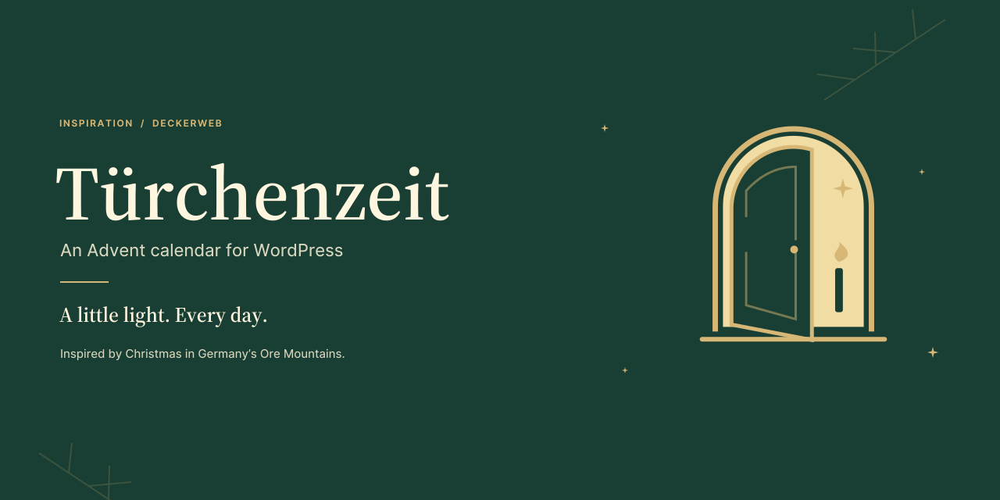
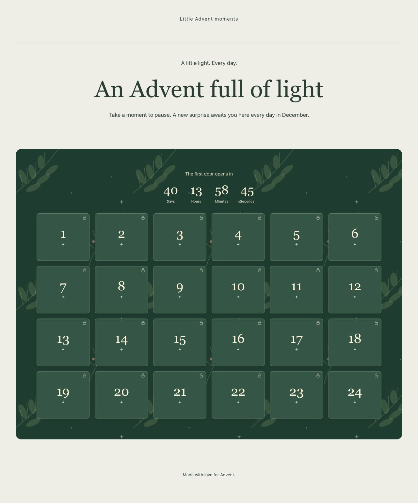

# Türchenzeit

[Deutsch](de/) · [GitHub](https://github.com/deckerweb/tuerchenzeit)

Türchenzeit brings 24 little moments of Advent to your WordPress website. Combine dedicated daily content with existing posts or pages, choose a design, and let a new door open each day. You can also create a fully editable Advent landing page, ready to return with fresh content each year. The German name evokes the season of opening little Advent calendar doors. Part of the Inspiration series, Türchenzeit draws on the Christmas warmth of Germany’s Ore Mountains.

**1.0.0 · WordPress 6.9+ · PHP 8.3+**

## At a glance

- **Your own Advent website** – an editable landing page with optional header and footer patterns.
- **24 doors, your contents** – combine your own daily contents with existing posts or pages.
- **Six designs with character** – custom accent colors and adjustable popups.
- **A new moment every day** – scheduled openings and an optional December countdown.
- **Design once, use every year** – prepare new annual editions at the existing address.
- **Prepare with confidence** – door grid, readiness check and private date preview.
- **Import complete day sets** – JSON/ZIP import including images.

- [Illustrated guide](Guide-en)
- [Full documentation](manual-en.html)
- [FAQ by topic](FAQ-en)

[Security](https://github.com/deckerweb/tuerchenzeit/security/policy) · [Support](https://github.com/deckerweb/tuerchenzeit/discussions)
